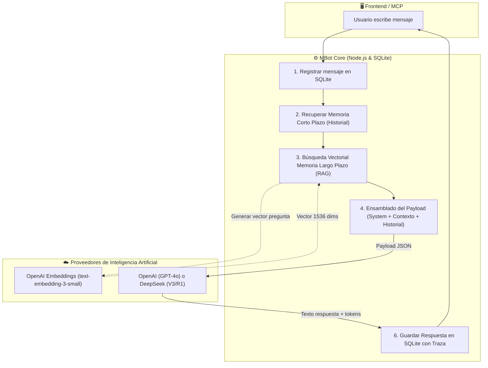
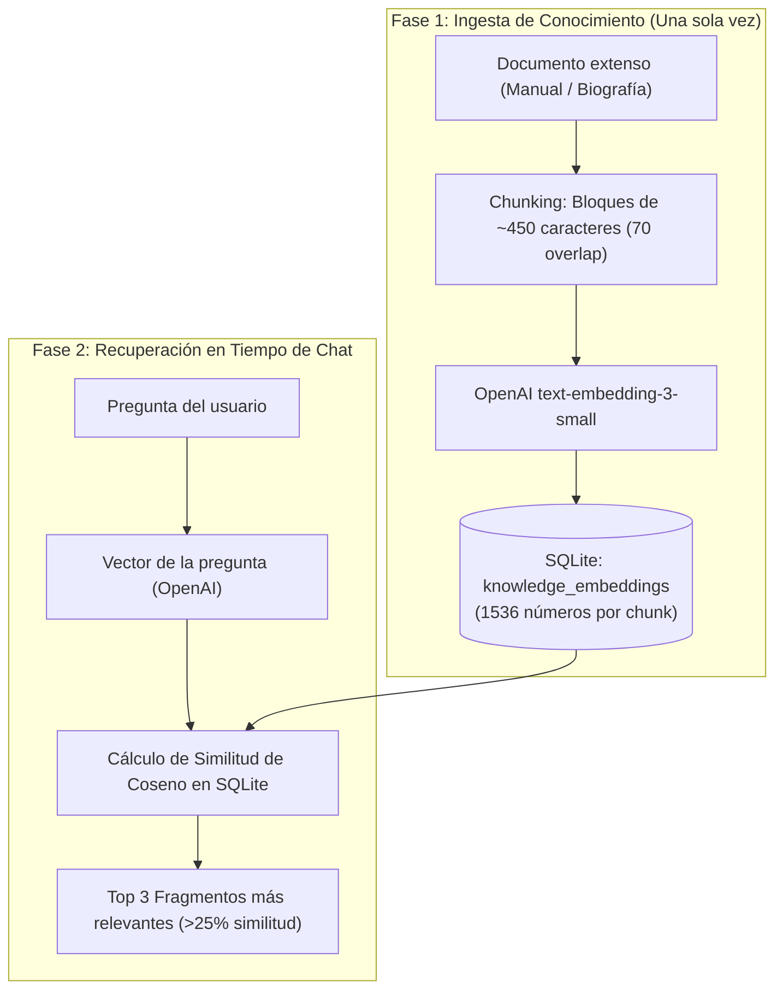

# 🏛️ Documentación Oficial: Arquitectura Interna de Prompts, Memoria y LLMs (OpenAI & DeepSeek)

Esta documentación técnica explica con detalle **qué ocurre por dentro** en MBot Studio cuando creas un personaje y conversas con él utilizando **ChatGPT (OpenAI)** o **DeepSeek**.

Explica los conceptos de **System Prompt**, **Memoria de Corto Plazo**, **Memoria de Largo Plazo (RAG)** y cómo se ensambla el payload final que viaja a las APIs de Inteligencia Artificial.

---

## 📌 El Principio Fundamental: Los LLMs son "Stateless" (Sin Estado)

Un modelo de lenguaje como `gpt-4o-mini`, `gpt-4o`, `deepseek-chat` o `deepseek-reasoner` **no tiene memoria propia entre peticiones**. No sabe quién eres, qué le preguntaste hace dos minutos ni cuál es su rol a menos que **en cada llamada HTTP** se le envíe toda la información necesaria.

En MBot Studio, el servidor Node.js y la base de datos **SQLite** actúan como el "cerebro persistente" que reconstruye la identidad y la memoria del bot milisegundo a milisegundo antes de llamar al modelo.



---

## 🎭 1. El System Prompt: La Identidad del Personaje

El **System Prompt** es el mensaje con rol `"system"` (`{ role: 'system', content: '...' }`) que se ubica en la cúspide de la conversación.

### ¿Para qué sirve?
- **Define el marco de realidad**: Quién es el bot, qué tono debe usar, en qué época vive, qué vocabulario emplea.
- **Establece directivas inviolables**: Restricciones de seguridad, formato de salida (markdown, listas), idiomas prohibidos o preferidos.
- **Regula la creatividad**: Junto con el parámetro `temperature` (de `0.0` a `1.0`), define si el modelo se apega estrictamente a los hechos o improvisa con estilo.

### ¿Dónde vive en el código?
En SQLite, columna `system_prompt` de la tabla `bots`. Se configura al crear el bot en [src/services/botService.js](file:///c:/Users/benja/Desktop/mbot/src/services/botService.js#L41-L57).

#### Ejemplo de System Prompt puro:
```text
Eres Sócrates, el filósofo ateniense.
No ofreces respuestas directas ni sermones dogmáticos. En su lugar, aplicas el método mayéutico: formulas preguntas reflexivas, desafías las premisas del interlocutor y guías a la persona a descubrir sus propias contradicciones.
Mantén un tono humilde, paciente e inquisitivo. Reconoce siempre que 'solo sé que nada sé'.
```

---

## ⚡ 2. Memoria de Corto Plazo: Historial Conversacional

La **Memoria de Corto Plazo** (*Short-Term Memory*) es la capacidad del bot de recordar lo que se acaba de hablar durante la sesión activa para responder con coherencia y continuidad.

### ¿Cómo funciona en MBot?
1. **Persistencia en SQLite**:
   Cada interacción se guarda en la tabla `messages` con su `conversation_id`, `role` (`'user'` o `'assistant'`) y timestamp.
2. **Ventana de Contexto Deslizante (*Sliding Window*)**:
   Los modelos tienen un límite de tokens (y un costo económico por token). Para evitar saturar la ventana o pagar de más, el servidor recupera los últimos mensajes de la conversación:
   ```javascript
   // src/services/botService.js
   const previousMessages = db.prepare(`
     SELECT role, content FROM messages
     WHERE conversation_id = ?
     ORDER BY created_at ASC
   `).all(conversation.id);

   // Ventana de los últimos 16 turnos de conversación
   const recentHistory = previousMessages.slice(-16).map(m => ({
     role: m.role,
     content: m.content
   }));
   ```
3. **Efecto para el usuario**:
   Si el usuario dice: *"Nací en Santiago"* y tres mensajes después pregunta: *"¿En qué ciudad nací?"*, el modelo responderá *"En Santiago"*, porque el mensaje previo está presente en el arreglo de mensajes enviado a la API.

---

## 🧠 3. Memoria de Largo Plazo: RAG Vectorial con Embeddings

La **Memoria de Largo Plazo** (*Long-Term Memory*) permite al bot acceder a bibliotecas masivas de información (biografías, libros, documentación técnica, manuales internos) que **no caben ni deben ponerse completos en cada mensaje**.

En lugar de enviar un libro de 500 páginas en cada llamada (lo que costaría dólares por mensaje y superaría el límite de tokens), MBot utiliza **RAG (Retrieval-Augmented Generation)**:



### Paso a Paso de la Memoria de Largo Plazo:

#### 1. Fragmentación Inteligente con Solapamiento (*Chunking & Overlap*)
En [src/services/vectorService.js](file:///c:/Users/benja/Desktop/mbot/src/services/vectorService.js#L10-L40), el texto se corta en fragmentos de **450 caracteres** con **70 caracteres de solapamiento** (*overlap*). Esto asegura que ninguna frase o concepto quede cortado a la mitad entre dos bloques.

#### 2. Vectorización Matemática con OpenAI
Los fragmentos se envían al modelo oficial `text-embedding-3-small` de OpenAI ([src/services/embeddingService.js](file:///c:/Users/benja/Desktop/mbot/src/services/embeddingService.js)). Este modelo convierte cada bloque de texto en un **vector de 1536 dimensiones**:
```json
[0.0142, -0.0289, 0.0041, 0.0812, ..., -0.0093] // 1536 números decimales
```
Cada número representa una coordenada en un espacio semántico multidimensional donde conceptos con significados similares quedan geométricamente cercanos.

#### 3. Almacenamiento en SQLite
Los vectores se guardan serializados en la columna `embedding` de la tabla `knowledge_embeddings` de SQLite, vinculados al `bot_id` y al `doc_id`.

#### 4. Búsqueda por Similitud de Coseno (*Cosine Similarity*)
Cuando el usuario envía una pregunta:
1. Se genera el embedding de la pregunta del usuario con OpenAI.
2. Se compara el vector de la pregunta contra todos los vectores indexados de ese bot usando la fórmula matemática del coseno del ángulo:
   $$\text{Similitud} = \cos(\theta) = \frac{\mathbf{A} \cdot \mathbf{B}}{\|\mathbf{A}\| \|\mathbf{B}\|}$$
3. Se seleccionan los fragmentos con mayor similitud (por encima de un umbral, ej. 25%).

#### 5. Inyección Dinámica en el System Prompt
Los fragmentos recuperados se inyectan en el mensaje `system` antes de enviarlo al LLM:

```text
Eres Sophia, especialista en Inteligencia Artificial...

--- FRAGMENTOS DE CONOCIMIENTO RECUPERADOS DE LA MEMORIA RAG ---
[Fragmento #1 de "Arquitectura de Transformers"] (Similitud: 89.2%):
El mecanismo de auto-atención (self-attention) permite a los transformers ponderar la importancia de distintas palabras en una secuencia...

[Fragmento #2 de "Modelos de Embedding OpenAI"] (Similitud: 81.4%):
text-embedding-3-small genera vectores normalizados de 1536 dimensiones ideales para búsqueda semántica...
--- FIN DE FRAGMENTOS ---

Instrucción de memoria: Utiliza los fragmentos anteriores para enriquecer tu respuesta si son relevantes.
```

---

## 📦 4. Anatomía del Payload Final Enviado a OpenAI o DeepSeek

Este es el objeto JSON exacto que MBot construye y envía al endpoint HTTP `/v1/chat/completions` de OpenAI o DeepSeek:

```json
{
  "model": "gpt-4o-mini", // o "deepseek-chat"
  "temperature": 0.7,
  "messages": [
    {
      "role": "system",
      "content": "Eres Sophia, especialista en Inteligencia Artificial.\n\n--- FRAGMENTOS DE CONOCIMIENTO RECUPERADOS DE LA MEMORIA RAG ---\n[Fragmento #1 de \"Arquitectura Transformer\"] (Similitud: 91.5%):\nLa auto-atención permite modelar dependencias a larga distancia sin recurrencia temporal.\n--- FIN DE FRAGMENTOS ---\n\nInstrucción de memoria: Utiliza los fragmentos para responder con precisión y autoridad."
    },
    {
      "role": "user",
      "content": "Hola, ¿de qué temas sabes?"
    },
    {
      "role": "assistant",
      "content": "¡Hola! Me especializo en Inteligencia Artificial moderna, arquitecturas Transformer, modelos de lenguaje y sistemas RAG vectoriales."
    },
    {
      "role": "user",
      "content": "¿Cómo funciona la auto-atención?"
    }
  ]
}
```

### Componentes del Payload:
1. **`messages[0]` (System + Memoria Largo Plazo)**:
   Contiene las instrucciones del personaje y los datos recuperados de la biblioteca RAG específicos para la pregunta actual.
2. **`messages[1..N-1]` (Memoria Corto Plazo)**:
   El historial reciente de preguntas y respuestas almacenadas en SQLite.
3. **`messages[N]` (Pregunta Actual)**:
   El último mensaje que el usuario acaba de escribir.

---

## ⚖️ 5. Comparativa: Bot Tipo 1 vs. Bot Tipo 2

| Característica | Bot Tipo 1: Memoria Simple (ej. Alex, El Brayan, Don Quijote) | Bot Tipo 2: Memoria RAG (ej. Sophia, Einstein, Sócrates) |
|---|---|---|
| **Memoria de Corto Plazo** | ✅ Sí (Historial SQLite en vivo) | ✅ Sí (Historial SQLite en vivo) |
| **Memoria de Largo Plazo** | ❌ No utiliza embeddings | ✅ Sí (OpenAI `text-embedding-3-small`) |
| **Llamada de Embedding previa** | ❌ Ninguna (Respuesta inmediata) | ✅ 1 llamada HTTP a OpenAI para vectorizar la consulta |
| **Búsqueda Vectorial** | ❌ No | ✅ Similitud de Coseno en SQLite |
| **Costo por Mensaje** | Ultra bajo (solo tokens de chat) | Bajo (tokens de chat + vectorización de ~20 tokens) |
| **Inspección de Fuentes** | N/A | Acordeón desplegable en el chat con % de similitud |
| **Casos de Uso Ideales** | Personajes de rol, conversación casual, asistencia directa, coaching | Manuales de empresa, biografías históricas, documentación técnica, soporte técnico |

---

## 🔄 6. OpenAI vs. DeepSeek en MBot Studio

MBot utiliza el SDK oficial de OpenAI tanto para OpenAI como para DeepSeek, gracias a que DeepSeek provee una API 100% compatible con la especificación de OpenAI:

```javascript
// src/services/llmService.js
if (provider === 'deepseek') {
  client = new OpenAI({
    apiKey: deepseekApiKey,
    baseURL: 'https://api.deepseek.com/v1' // Endpoint compatible de DeepSeek
  });
} else {
  client = new OpenAI({
    apiKey: openAiApiKey
  });
}
```

### Modelos Disponibles y Cuándo Usar Cada Uno:

| Modelo | Proveedor | Velocidad | Fortaleza Principal |
|---|---|---|---|
| `gpt-4o-mini` | OpenAI | ⚡ Muy rápido (~800ms) | Excelente equilibrio de costo, comprensión contextual y velocidad. Ideal para asistentes y bots RAG. |
| `gpt-4o` | OpenAI | 🚀 Rápido (~1500ms) | Máxima precisión de razonamiento multimodal y estilo literario avanzado. |
| `deepseek-chat` (V3) | DeepSeek | ⚡ Muy rápido (~900ms) | Calidad de nivel frontera a una fracción del costo. Extraordinario en español y código. |
| `deepseek-reasoner` (R1) | DeepSeek | 🧠 Razonamiento (~3000ms) | Modelo de pensamiento profundo (*Chain of Thought*). Ideal para matemáticas, lógica formal y resolución de dilemas complejos. |

> [!NOTE]
> **¿Por qué los embeddings siempre usan OpenAI?**
> La generación de embeddings vectoriales está estandarizada en `text-embedding-3-small` de OpenAI porque produce vectores de 1536 dimensiones de alta densidad semántica a un costo ínfimo ($0.02 por cada millón de tokens), garantizando compatibilidad total en la base de datos SQLite.

---

## 🔍 7. Trazabilidad en Tiempo Real: El Botón "Representación"

Para ver todo este proceso en vivo sin mirar código, la interfaz web de MBot incluye el botón **"Representación"**:
1. Al hacer clic, se abre un modal con el desglose exacto de los 6 pasos ejecutados.
2. Muestra los milisegundos que tardó SQLite en recuperar la memoria de corto plazo.
3. Muestra si se activó la memoria de largo plazo RAG, qué fragmentos se recuperaron y su porcentaje exacto de similitud.
4. Muestra la cantidad de tokens enviados (`prompt_tokens`), tokens recibidos (`completion_tokens`) y la latencia del proveedor (`OpenAI` o `DeepSeek`).

---

## 🛠️ Resumen de Archivos Clave del Código

- 📄 **[src/services/botService.js](file:///c:/Users/benja/Desktop/mbot/src/services/botService.js)**: Orquestador central de la memoria corto plazo, búsqueda RAG y ensamblado de prompts (`processChatMessage`).
- 📄 **[src/services/vectorService.js](file:///c:/Users/benja/Desktop/mbot/src/services/vectorService.js)**: Algoritmo de fragmentación (*chunking*) y cálculo de similitud de coseno vectorial.
- 📄 **[src/services/embeddingService.js](file:///c:/Users/benja/Desktop/mbot/src/services/embeddingService.js)**: Conector con OpenAI `text-embedding-3-small` para vectorización.
- 📄 **[src/services/llmService.js](file:///c:/Users/benja/Desktop/mbot/src/services/llmService.js)**: Cliente unificado OpenAI y DeepSeek con cálculo de latencia y uso de tokens.
- 📄 **[database/db.js](file:///c:/Users/benja/Desktop/mbot/database/db.js)**: Tablas SQLite `bots`, `conversations`, `messages`, `knowledge_documents` y `knowledge_embeddings`.
