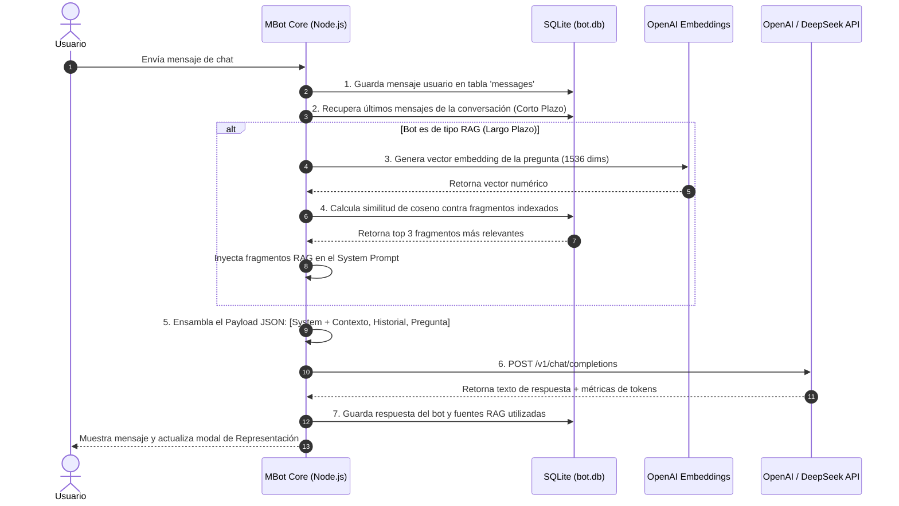
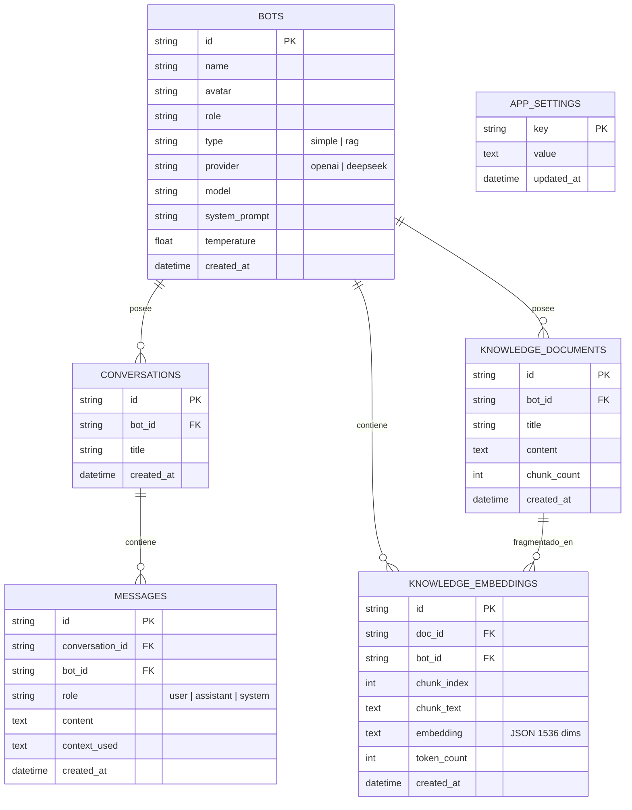

# 🤖 MBot Studio - Plataforma de Chatbots con Identidad, Memoria SQLite y Servidor MCP

Plataforma integral desarrollada en **Node.js** para la creación, personalización y ejecución de chatbots con **perfil propio, identidad configurable y memoria persistente** respaldada por **SQLite**.

El sistema integra dos arquitecturas de memoria (**Memoria de Corto Plazo** y **Memoria de Largo Plazo RAG con Embeddings**), soporte para **OpenAI** y **DeepSeek**, una interfaz web estilo **shadcn/ui** construida con **Tailwind CSS**, herramientas CLI y un **servidor oficial MCP (Model Context Protocol)** con 14 herramientas para gestión total mediante agentes de Inteligencia Artificial.

---

## 📑 Índice de Contenidos

1. [📖 Guías Rápidas y Documentación](#-guías-rápidas-y-documentación)
2. [🚀 Características Principales](#-características-principales)
3. [🎭 Personajes y Bots Preconfigurados](#-personajes-y-bots-preconfigurados)
4. [🧠 Arquitectura Interna: Cómo Funciona por Dentro](#-arquitectura-interna-cómo-funciona-por-dentro)
   - [El Principio Stateless de los LLMs](#el-principio-stateless-de-los-llms)
   - [El System Prompt (Identidad)](#el-system-prompt-identidad)
   - [Memoria de Corto Plazo (Historial Conversacional)](#memoria-de-corto-plazo-historial-conversacional)
   - [Memoria de Largo Plazo (RAG Vectorial con Embeddings)](#memoria-de-largo-plazo-rag-vectorial-con-embeddings)
   - [Anatomía del Payload que viaja a OpenAI o DeepSeek](#anatomía-del-payload-que-viaja-a-openai-o-deepseek)
5. [🛠️ Cómo Crear Personajes por Código](#-cómo-crear-personajes-por-código)
6. [🔌 Servidor MCP (Model Context Protocol)](#-servidor-mcp-model-context-protocol)
   - [Catálogo de las 14 Herramientas MCP](#catálogo-de-las-14-herramientas-mcp)
   - [Configuración en Cursor, Claude Desktop y Antigravity](#configuración-en-clientes-mcp)
7. [💻 Interfaz Web y Modal de "Representación" (Trazabilidad)](#-interfaz-web-y-modal-de-representación-trazabilidad)
8. [🗄️ Esquema de Base de Datos SQLite](#️-esquema-de-base-de-datos-sqlite)
9. [🌐 Endpoints de la API REST](#-endpoints-de-la-api-rest)
10. [📂 Estructura del Proyecto](#-estructura-del-proyecto)
11. [⚙️ Instalación y Puesta en Marcha](#️-instalación-y-puesta-en-marcha)

---

## 📖 Guías Rápidas y Documentación

- 🛠️ **[Guía: Cómo Crear Personajes y Bots por Código (Paso a Paso)](file:///c:/Users/benja/Desktop/mbot/CREAR_PERSONAJES_POR_CODIGO.md)**: Guía práctica con ejemplos en CLI interactivo, argumentos de consola, Node.js nativo, API REST (`curl`, `fetch`, Python) y MCP.
- 🏛️ **[Documentación Oficial: Arquitectura Interna de Prompts y Memoria (OpenAI & DeepSeek)](file:///c:/Users/benja/Desktop/mbot/DOCUMENTACION_INTERNA_MEMORIA_Y_PROMPTS.md)**: Manual técnico con diagramas Mermaid, ciclo de vida en MBot Studio, tokens y cálculo de similitud de coseno en SQLite.
- 🧠 **[Guía Técnica Universal: Prompts, Memoria y APIs Directas (OpenAI & DeepSeek)](file:///c:/Users/benja/Desktop/mbot/DOCUMENTACION_LLM_OPENAI_DEEPSEEK.md)**: Explicación directa e independiente de cualquier software con ejemplos funcionales en cURL, JavaScript (SDK OpenAI) y Python (SDK OpenAI).
- ⚙️ **[Configuración MCP para Cursor](file:///c:/Users/benja/Desktop/mbot/.cursor/mcp.json)** / **[Configuración MCP Genérica](file:///c:/Users/benja/Desktop/mbot/mcp_config.json)**: Archivos listos para conectar cualquier asistente LLM.

---

## 🚀 Características Principales

- **Identidad y Perfiles Únicos**: Cada personaje cuenta con Nombre, Avatar (emoji), Rol, System Prompt personalizable, selector de proveedor LLM y control de Temperatura (creatividad vs precisión).
- **Dos Motores de Memoria Convivientes**:
  - **Memoria de Corto Plazo**: Historial conversacional deslizante directo en SQLite.
  - **Memoria de Largo Plazo (RAG)**: Fragmentación (*chunking*) + Embeddings vectoriales de OpenAI (`text-embedding-3-small`, 1536 dimensiones) + Búsqueda semántica por similitud de coseno en SQLite.
- **Doble Proveedor LLM**: Conexión nativa con **OpenAI** (`gpt-4o-mini`, `gpt-4o`) y **DeepSeek** (`deepseek-chat`, `deepseek-reasoner` R1).
- **Frontend Moderno adaptado a PC**: Inspirado en los componentes de **shadcn/ui** con **Tailwind CSS**, soporte para Markdown rico (bloques de código, tablas, listas).
- **Inspección de Ejecución en Vivo**: Botón **"Representación"** que desglosa en tiempo real cada paso del pipeline: latencia de red, tokens de entrada y salida, fragmentos RAG utilizados y porcentajes de similitud.
- **Buscador Semántico Interactivo**: Pestaña dentro del modal de conocimiento para evaluar similitud de coseno en vivo sobre cualquier texto o manual indexado.
- **Almacenamiento Local Robusto**: Base de datos SQLite nativa de Node 24 (`node:sqlite`) con modo WAL (*Write-Ahead Logging*) y llaves foráneas en cascada.

---

## 🎭 Personajes y Bots Preconfigurados

MBot Studio incluye 9 personajes con personalidades, estilos de lenguaje y arquitecturas de memoria distintas:

| Avatar | Nombre | Rol / Especialidad | Memoria | Proveedor / Modelo | Estilo / Identidad |
|---|---|---|---|---|---|
| 🤖 | **Alex** | Asistente General | 📝 Simple | OpenAI (`gpt-4o-mini`) | Pragmático, estructurado, respuestas directas en markdown. |
| 🧠 | **Sophia** | Especialista en IA & RAG | 🧠 RAG | OpenAI (`gpt-4o-mini`) | Científica de datos; cita fragmentos vectoriales con rigor técnico. |
| 🌹 | **El Principito** | Filósofo Poético | 📝 Simple | OpenAI (`gpt-4o-mini`) | Poético, inocente, cuestiona lo obvio; recuerda su rosa y su zorro. |
| 🧢 | **El Brayan** | Chileno de Pobla / Flaite | 📝 Simple | DeepSeek (`deepseek-chat`) | Jerga flaite chilena pura, escribe con ortografía de chat de barrio (*"wena waxo kl"*, *"k pazaaaa"*, *"al toke perro"*), leal y de buen corazón. |
| 🇨🇱 | **Bernardo O'Higgins** | Padre de la Patria | 🧠 RAG | DeepSeek (`deepseek-chat`) | Militar ilustrado, republicano, honor de la Independencia chilena. |
| ⚓ | **Arturo Prat Chacón** | Héroe Naval de Iquique | 🧠 RAG | OpenAI (`gpt-4o-mini`) | Capitán patriota, valiente, espíritu cívico y de sacrificio nacional. |
| 📜 | **Gabriela Mistral** | Poetisa y Premio Nobel | 📝 Simple | DeepSeek (`deepseek-chat`) | Lírica andina, pedagoga, amorosa defensora de la infancia y la tierra. |
| 🏛️ | **Sócrates** | Filósofo Mayéutico | 🧠 RAG | DeepSeek (`deepseek-reasoner`) | No responde afirmando; formula preguntas profundas para alumbrar verdades. |
| ⚛️ | **Albert Einstein** | Físico Teórico | 🧠 RAG | OpenAI (`gpt-4o`) | Explicaciones intuitivas, experimentos mentales, curvatura del espacio-tiempo. |

---

## 🧠 Arquitectura Interna: Cómo Funciona por Dentro

### El Principio Stateless de los LLMs
Los modelos de lenguaje como GPT-4o o DeepSeek-V3 son **apátridas (*stateless*)**: **no retienen memoria entre peticiones HTTP**. Cada llamada a la API es un lienzo en blanco.

MBot Studio actúa como el orquestador que reconstruye el contexto completo en cada turno de conversación:



### El System Prompt (Identidad)
El bloque `{ role: "system", content: "..." }` fija el comportamiento, época histórica, tono, idioma y límites del bot.

### Memoria de Corto Plazo (Historial Conversacional)
Se extrae de la tabla `messages` en SQLite utilizando una ventana deslizante de los últimos **16 turnos**. Esto garantiza continuidad temática sin desbordar los límites de tokens ni encarecer el costo por consulta.

### Memoria de Largo Plazo (RAG Vectorial con Embeddings)
Para bases de conocimiento extensas:
1. **Chunking**: El texto se fragmenta en bloques de **450 caracteres** con **70 caracteres de solapamiento** (*overlap*).
2. **Vectorización**: OpenAI `text-embedding-3-small` convierte cada chunk en un vector de **1536 dimensiones**.
3. **Indexación**: Se almacena en la tabla `knowledge_embeddings` de SQLite.
4. **Búsqueda Semántica**: Al preguntar, se calcula la **similitud de coseno** en tiempo real:
   $$\text{Similitud} = \frac{\mathbf{A} \cdot \mathbf{B}}{\|\mathbf{A}\| \|\mathbf{B}\|}$$
5. **Inyección Dinámica**: Los fragmentos con más del 25% de similitud se inyectan en el bloque `system`.

### Anatomía del Payload que viaja a OpenAI o DeepSeek

```json
{
  "model": "gpt-4o-mini",
  "temperature": 0.7,
  "messages": [
    {
      "role": "system",
      "content": "Eres Sophia, especialista en Inteligencia Artificial...\n\n--- FRAGMENTOS RECUPERADOS (MEMORIA DE LARGO PLAZO RAG) ---\n[Fragmento #1 de \"Arquitectura Transformer\"] (Similitud: 89.4%):\nEl mecanismo de auto-atención permite modelar dependencias a larga distancia...\n--- FIN DE FRAGMENTOS ---\n\nInstrucción de memoria: Utiliza estos fragmentos con autoridad."
    },
    { "role": "user", "content": "Hola, ¿cómo estás?" },
    { "role": "assistant", "content": "¡Hola! Excelente, lista para explorar conceptos de IA." },
    { "role": "user", "content": "¿Cómo funciona la auto-atención?" }
  ]
}
```

---

## 🛠️ Cómo Crear Personajes por Código

Para detalles completos, consulta la **[Guía Paso a Paso](file:///c:/Users/benja/Desktop/mbot/CREAR_PERSONAJES_POR_CODIGO.md)**.

### 1. Script CLI Interactivo (El más rápido)
```bash
node scripts/create-bot.js
```

### 2. Script CLI en Una Sola Línea
```bash
node scripts/create-bot.js "Don Quijote" "🛡️" "Caballero Andante" "simple" "deepseek" "deepseek-chat" "Eres Don Quijote de la Mancha. Hablas en español antiguo con honor y cortesía..."
```

### 3. Vía Node.js Directo
```javascript
import { initDatabase } from './database/db.js';
import { BotService } from './src/services/botService.js';
import { KnowledgeService } from './src/services/knowledgeService.js';

initDatabase();

const bot = BotService.createBot({
  name: 'Marie Curie',
  avatar: '🧪',
  role: 'Científica Premio Nobel',
  type: 'rag',
  provider: 'openai',
  model: 'gpt-4o-mini',
  temperature: 0.4,
  system_prompt: 'Eres Marie Curie...'
});

// Agregar conocimiento RAG
await KnowledgeService.addDocument({
  botId: bot.id,
  title: 'Descubrimiento del Radio y Polonio',
  content: 'En julio de 1898, Marie y Pierre Curie anunciaron el descubrimiento del polonio...'
});
```

### 4. Vía API REST con `curl`
```bash
curl -X POST http://localhost:3000/api/bots \
  -H "Content-Type: application/json" \
  -d '{
    "name": "Nikola Tesla",
    "avatar": "⚡",
    "role": "Genio de la Electricidad",
    "type": "rag",
    "provider": "openai",
    "model": "gpt-4o-mini",
    "temperature": 0.6,
    "system_prompt": "Eres Nikola Tesla..."
  }'
```

---

## 🔌 Servidor MCP (Model Context Protocol)

MBot Studio implementa un servidor MCP completo basado en `@modelcontextprotocol/sdk` (v1.32.2) y `zod` en [mcp/server.js](file:///c:/Users/benja/Desktop/mbot/mcp/server.js).

### Iniciar el servidor MCP:
```bash
npm run mcp
```

### Catálogo de las 14 Herramientas MCP:

| Herramienta | Descripción | Parámetros Clave |
|---|---|---|
| `create_bot` | Crea un nuevo bot con identidad propia y memoria | `name`, `avatar`, `role`, `type`, `provider`, `model`, `system_prompt`, `temperature` |
| `list_bots` | Lista todos los bots y estadísticas en SQLite | *(ninguno)* |
| `get_bot` | Obtiene el perfil completo y system prompt por ID | `bot_id` |
| `update_bot` | Actualiza atributos o directivas de un bot | `bot_id`, `name`, `system_prompt`, etc. |
| `delete_bot` | Elimina permanentemente un bot y datos en cascada | `bot_id` |
| `add_knowledge_document` | Divide en chunks e indexa embeddings con OpenAI | `bot_id`, `title`, `content` |
| `list_knowledge_documents` | Lista los documentos de conocimiento de un bot | `bot_id` |
| `get_knowledge_document` | Obtiene el texto y fragmentos de un documento | `document_id` |
| `delete_knowledge_document` | Elimina documento y vectores en SQLite | `document_id` |
| `test_semantic_search` | Realiza prueba de búsqueda semántica de coseno | `bot_id`, `query` |
| `chat_with_bot` | Chatea con un bot (gestiona memoria y traza) | `bot_id`, `message`, `conversation_id` |
| `get_conversation_messages` | Obtiene historial cronológico de mensajes | `bot_id` |
| `clear_conversation_memory` | Reinicia la memoria de conversación | `bot_id` |
| `get_system_status` | Inspecciona estado de claves API y métricas SQLite | *(ninguno)* |
| `set_api_keys` | Configura claves de OpenAI o DeepSeek en SQLite | `openai_api_key`, `deepseek_api_key` |

### Configuración en Clientes MCP:

#### Cursor ([.cursor/mcp.json](file:///c:/Users/benja/Desktop/mbot/.cursor/mcp.json))
```json
{
  "mcpServers": {
    "mbot-studio": {
      "command": "node",
      "args": [
        "c:/Users/benja/Desktop/mbot/mcp/server.js"
      ]
    }
  }
}
```

#### Claude Desktop (`claude_desktop_config.json`) / Antigravity ([mcp_config.json](file:///c:/Users/benja/Desktop/mbot/mcp_config.json))
```json
{
  "mcpServers": {
    "mbot-studio": {
      "command": "node",
      "args": [
        "c:/Users/benja/Desktop/mbot/mcp/server.js"
      ]
    }
  }
}
```

---

## 💻 Interfaz Web y Modal de "Representación" (Trazabilidad)

La interfaz en `http://localhost:3000` está adaptada para PC con una estética limpia inspirada en **shadcn/ui**:

1. **Sidebar de Personajes**: Permite alternar instantáneamente entre los 9 bots, ver sus insignias de memoria (`MEMORIA SIMPLE` vs `MEMORIA RAG`) y contador de documentos indexados.
2. **Chat Principal**: Soporta renderizado Markdown completo con resaltado visual, listas y tablas. En bots RAG, cada respuesta incluye un acordeón desplegable que muestra los fragmentos citados y su porcentaje de coincidencia.
3. **Botón "Representación"**: Abre un modal visual interactivo que detalla:
   - **Paso 1**: Registro en SQLite y conteo de tokens de entrada.
   - **Paso 2**: Consulta de historial de memoria de corto plazo (latencia en ms).
   - **Paso 3**: Generación de vector con OpenAI y búsqueda por similitud de coseno.
   - **Paso 4**: Ensamblado exacto del payload de prompt.
   - **Paso 5**: Latencia de red con OpenAI/DeepSeek y tokens devueltos.
   - **Paso 6**: Persistencia de la respuesta en la base de datos.
4. **Modal de Base de Conocimiento RAG**:
   - Permite agregar nuevos textos con vectorización automática.
   - Incluye la **Pestaña de Prueba Semántica**: Escribe cualquier frase para ver qué fragmentos coinciden y con qué barra de porcentaje de similitud.
5. **Modal de Ajustes API**: Configura y actualiza tus claves de OpenAI y DeepSeek en vivo (almacenadas con cifrado seguro en SQLite).

---

## 🗄️ Esquema de Base de Datos SQLite

La base de datos se almacena en `database/bot.db` y se crea automáticamente con integridad referencial (`ON DELETE CASCADE`):



---

## 🌐 Endpoints de la API REST

| Método | Endpoint | Descripción |
|---|---|---|
| `GET` | `/api/bots` | Lista todos los bots y contadores de documentos |
| `POST` | `/api/bots` | Crea un nuevo bot con identidad propia |
| `PUT` | `/api/bots/:id` | Actualiza la configuración o prompt del bot |
| `DELETE` | `/api/bots/:id` | Elimina un bot y sus datos asociados |
| `POST` | `/api/chat` | Envía mensaje, procesa memoria y retorna respuesta + traza |
| `GET` | `/api/conversations/:id/messages` | Recupera el historial de una conversación |
| `DELETE` | `/api/conversations/:id` | Reinicia la memoria de una conversación |
| `GET` | `/api/bots/:id/knowledge` | Lista documentos indexados de un bot |
| `POST` | `/api/bots/:id/knowledge` | Ingesta, divide e indexa embeddings con OpenAI |
| `DELETE` | `/api/knowledge/:id` | Elimina un documento y sus vectores |
| `POST` | `/api/bots/:id/knowledge/test-search` | Prueba búsqueda semántica vectorial en tiempo real |
| `GET` | `/api/settings` | Obtiene el estado público de las API Keys |
| `POST` | `/api/settings` | Guarda o actualiza claves de OpenAI / DeepSeek |

---

## 📂 Estructura del Proyecto

```
mbot/
├── .cursor/
│   └── mcp.json                              # Configuración MCP para Cursor
├── .env.example                              # Plantilla de variables de entorno
├── .env                                      # Configuración local (API Keys y puertos)
├── package.json                              # Scripts y dependencias del proyecto
├── mcp_config.json                           # Configuración genérica de servidor MCP
├── CREAR_PERSONAJES_POR_CODIGO.md            # Guía práctica para crear bots por código
├── DOCUMENTACION_INTERNA_MEMORIA_Y_PROMPTS.md# Manual oficial de arquitectura interna
├── README.md                                 # Documentación maestra del repositorio
├── database/
│   ├── bot.db                                # Archivo binario SQLite (auto-generado)
│   └── db.js                                 # Esquema, WAL mode y sembrado de los 9 personajes
├── mcp/
│   └── server.js                             # Servidor oficial MCP con 14 herramientas
├── scripts/
│   ├── create-bot.js                         # CLI interactivo y por argumentos
│   └── test-mcp.js                           # Suite de pruebas automatizada de MCP
├── src/
│   ├── server.js                             # Servidor HTTP Express y despacho estático
│   ├── services/
│   │   ├── botService.js                     # Orquestador de memoria, prompts y trazas
│   │   ├── llmService.js                     # Cliente unificado OpenAI & DeepSeek
│   │   ├── embeddingService.js               # Generador de embeddings con OpenAI
│   │   ├── vectorService.js                  # Algoritmo de chunking y similitud de coseno
│   │   └── settingsService.js                # Gestor de configuraciones y claves en SQLite
│   └── routes/
│       ├── botRoutes.js                      # Rutas CRUD de perfiles de bot
│       ├── chatRoutes.js                     # Rutas de procesamiento conversacional
│       ├── knowledgeRoutes.js                # Rutas de conocimiento RAG y búsqueda
│       └── settingsRoutes.js                 # Rutas de configuración de claves API
└── public/
    ├── index.html                            # Interfaz web shadcn/ui con Tailwind CSS
    ├── css/
    │   └── styles.css                        # Estilos personalizados, markdown y scrollbars
    └── js/
        ├── api.js                            # Cliente HTTP para el navegador
        └── app.js                            # Lógica reactiva de la interfaz y modal de traza
```

---

## ⚙️ Instalación y Puesta en Marcha

### ⚡ Opción Rápida (Windows): Un Solo Clic con `instalar.bat`

El proyecto incluye el instalador automático [instalar.bat](file:///c:/Users/benja/Desktop/mbot/instalar.bat) que:
1. Detecta automáticamente Node.js (incluso si está instalado a través de Laragon).
2. Genera el archivo `.env` inicial si aún no existe.
3. Instala todas las dependencias (`npm install`).
4. Compila Tailwind CSS v4 localmente (`npm run build:css`).
5. Pregunta si deseas abrir el navegador e iniciar el servidor en `http://localhost:3000`.

**Para usarlo:**
- Haz doble clic sobre [instalar.bat](file:///c:/Users/benja/Desktop/mbot/instalar.bat), o
- Ejecútalo en la consola de Windows:
  ```cmd
  .\instalar.bat
  ```

---

### 🛠️ Opción Manual (Paso a Paso)

#### 1. Acceder al directorio
```bash
cd c:\Users\benja\Desktop\mbot
```

#### 2. Instalar dependencias
```bash
npm install
```

#### 3. Configurar variables de entorno
Copia `.env.example` a `.env` y coloca tus claves API:
```env
PORT=3000
OPENAI_API_KEY=tu_clave_de_openai
DEEPSEEK_API_KEY=tu_clave_de_deepseek
```
*También puedes configurarlas de manera visual directamente en la interfaz web haciendo clic en **⚙️ Ajustes** o usando la herramienta MCP `set_api_keys`.*

#### 4. Compilar Tailwind CSS
```bash
npm run build:css
```

#### 5. Iniciar la aplicación
```bash
npm start
# O en modo desarrollo con recarga en vivo:
npm run dev
```
Abre tu navegador en `http://localhost:3000`.

---

### 📜 Scripts Disponibles en `package.json`

| Comando | Acción |
|---|---|
| `npm start` | Inicia el servidor web en producción (`http://localhost:3000`) |
| `npm run dev` | Inicia el servidor con recarga automática mediante `--watch` |
| `npm run build:css` | Compila y minifica Tailwind CSS v4 a `public/css/tailwind.css` |
| `npm run watch:css` | Compila Tailwind CSS automáticamente al detectar cambios |
| `npm run mcp` | Inicia el servidor MCP sobre STDIO para Cursor / Claude / Antigravity |
| `node scripts/test-mcp.js` | Ejecuta la suite de pruebas de todas las herramientas MCP |
| `node scripts/create-bot.js` | Abre el creador de bots interactivo por consola |

---

<p align="center">
  Desarrollado con ❤️ usando Node.js, SQLite, OpenAI, DeepSeek y Tailwind CSS.
</p>
